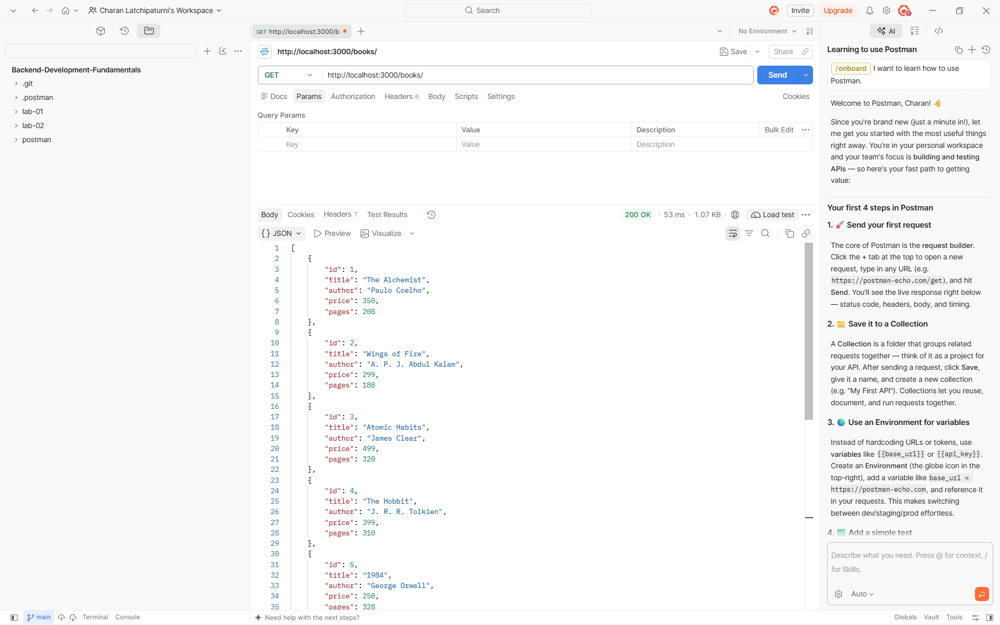
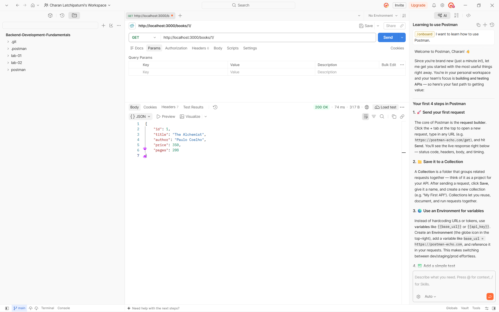
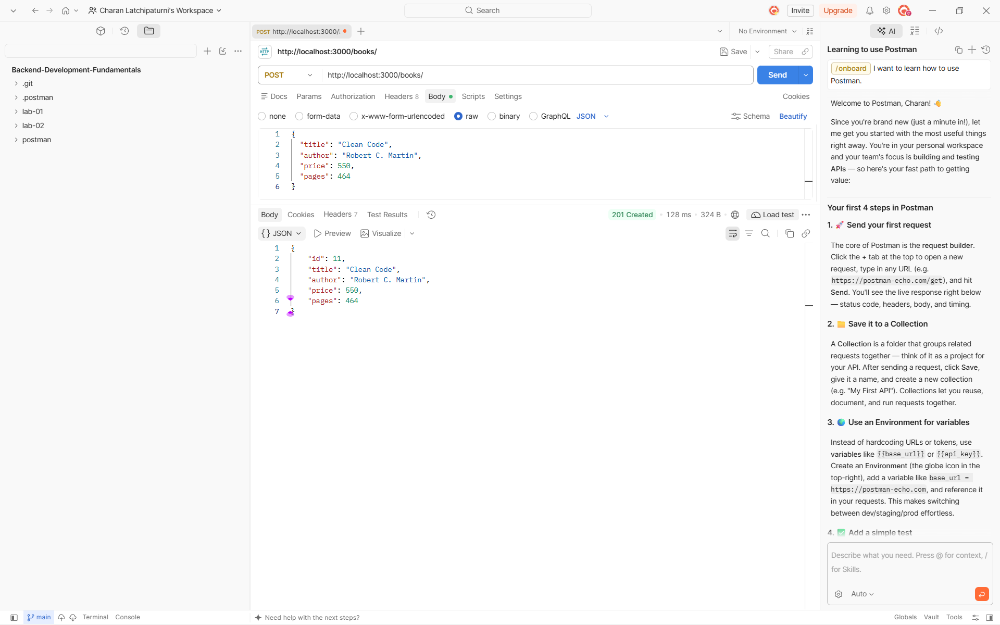
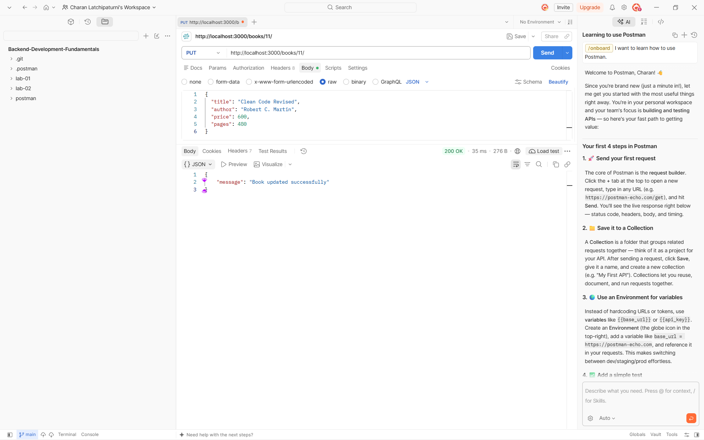
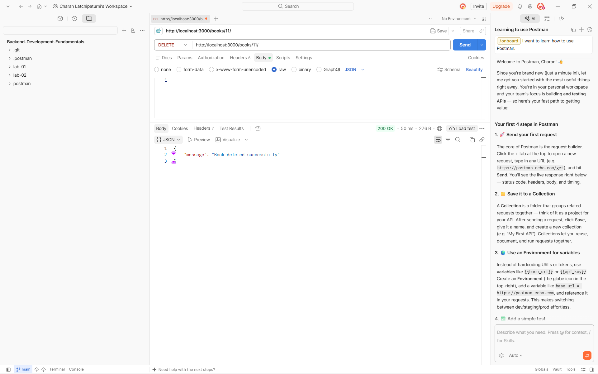
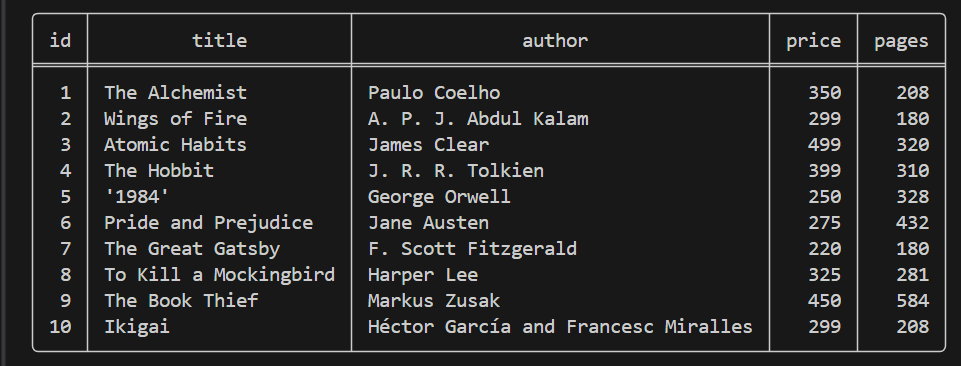

# Lab 2: SQLite Database and CRUD REST API


## Student Information

- **Name:** S. Karthikeya Reddy  
- **Registration Number:** 252U1R8089  
- **Class:** B.Tech CSE(QE) – 2B  
- **Section:** S-13 204  
- **Repository:** [https://github.com/jayraguhuram-commits/backend_lab_2](https://github.com/jayraguhuram-commits/backend_lab_2)  
- **Live Deployed API:** [https://backend-development-fundamentals-1-fzeu.onrender.com]https://backend-lab-2-1-2pt4.onrender.com/

---


The objective of this lab is to develop and deploy a production-ready RESTful backend API using **Express.js** and **SQLite**. The service manages a digital book collection and supports full **CRUD** (Create, Read, Update, Delete) operations over HTTP, complete with database persistence, auto-migration, input validation, and cloud deployment compatibility.


- **Production-Ready Cloud Architecture**: Configured with dynamic port binding (`process.env.PORT`), host binding on `0.0.0.0`, and CORS middleware.
- **Health & Discovery Endpoints**: Provides `GET /` API directory and `GET /health` uptime probe.
- **Dual Route Tolerance**: Gracefully routes requests both with and without trailing slashes (e.g., `/books` and `/books/`).
- **Container Ready**: Includes `render.yaml` for Render Blueprints and multi-platform `Dockerfile`.

---

## 2. Technologies Used

- **Runtime Environment:** [Node.js](https://nodejs.org/) (v18.x, v20.x, v22.x, v24.x)
- **Web Framework:** [Express.js](https://expressjs.com/) (v5.x)
- **Database:** [SQLite3](https://sqlite.org/) with the `sqlite` promise-based driver
- **Cross-Origin Resource Sharing:** `cors` middleware
- **Development Tooling:** `nodemon` for auto-reloading
- **API Testing:** Postman & automated integration test suite (`test_server.js`)
- **Deployment & Cloud:** [Render](https://render.com/) & [Docker](https://www.docker.com/)

---

## 3. Directory Structure

```text
backend_lab_2/
├── database/
│   └── books.db            # SQLite database file
├── screenshots/
│   ├── get-all-books.png   # Postman: GET /books
│   ├── get-book-by-id.png  # Postman: GET /books/:bookId
│   ├── post-book.png       # Postman: POST /books
│   ├── put-book.png        # Postman: PUT /books/:bookId
│   ├── delete-book.png     # Postman: DELETE /books/:bookId
│   └── sqlite-database.png # SQLite CLI verification
├── .dockerignore           # Excluded files for container builds
├── .env.example            # Environment variables template
├── .gitignore              # Git ignored artifacts & credentials
├── Dockerfile              # Container definition for Docker/Fly.io
├── README.md               # Project documentation
├── app.js                  # Main Express application & SQLite connection
├── package.json            # Node.js dependencies and run scripts
├── render.yaml             # Render infrastructure blueprint
└── test_server.js          # Automated end-to-end integration test
```

---

## 4. Database Design & Sample Data

### Table Schema: `book`

```sql
CREATE TABLE IF NOT EXISTS book (
    id INTEGER PRIMARY KEY AUTOINCREMENT,
    title TEXT NOT NULL,
    author TEXT NOT NULL,
    price INTEGER NOT NULL,
    pages INTEGER NOT NULL
);
```

### Data Dictionary

| Column | Data Type | Constraints | Description |
|---|---|---|---|
| `id` | INTEGER | PRIMARY KEY AUTOINCREMENT | Unique book identifier |
| `title` | TEXT | NOT NULL | Title of the book |
| `author` | TEXT | NOT NULL | Author of the book |
| `price` | INTEGER | NOT NULL | Price in INR |
| `pages` | INTEGER | NOT NULL | Page count |

### Pre-Seeded Sample Records

The database includes 10 default book records that auto-seed if the database table is empty:

| ID | Title | Author | Price | Pages |
|---|---|---|---|---|
| 1 | The Alchemist | Paulo Coelho | 350 | 208 |
| 2 | Wings of Fire | A. P. J. Abdul Kalam | 299 | 180 |
| 3 | Atomic Habits | James Clear | 499 | 320 |
| 4 | The Hobbit | J. R. R. Tolkien | 399 | 310 |
| 5 | 1984 | George Orwell | 250 | 328 |
| 6 | Pride and Prejudice | Jane Austen | 275 | 432 |
| 7 | The Great Gatsby | F. Scott Fitzgerald | 220 | 180 |
| 8 | To Kill a Mockingbird | Harper Lee | 325 | 281 |
| 9 | The Book Thief | Markus Zusak | 450 | 584 |
| 10 | Ikigai | Héctor García and Francesc Miralles | 299 | 208 |

---

## 5. API Endpoints Specification

| Method | Endpoint | Description | Status Code |
|---|---|---|---|
| `GET` | `/` | API status, root directory, and endpoint routes | `200 OK` |
| `GET` | `/health` | Health check probe for uptime monitoring | `200 OK` |
| `GET` | `/books` or `/books/` | Retrieve all books | `200 OK` |
| `GET` | `/books/:bookId` | Retrieve a single book by ID | `200 OK` / `404 Not Found` |
| `POST` | `/books` or `/books/` | Create a new book | `201 Created` / `400 Bad Request` |
| `PUT` | `/books/:bookId` | Update an existing book by ID | `200 OK` / `400` / `404` |
| `DELETE` | `/books/:bookId` | Delete a book by ID | `200 OK` / `404 Not Found` |

---

### Detailed Endpoint Examples

#### 1. API Overview
- **Request:** `GET /`
- **Response (`200 OK`):**
  ```json
  {
    "message": "Welcome to Lab 2: SQLite database and CRUD routes API",
    "status": "online",
    "endpoints": {
      "getAllBooks": "GET /books",
      "getBookById": "GET /books/:bookId",
      "addBook": "POST /books",
      "updateBook": "PUT /books/:bookId",
      "deleteBook": "DELETE /books/:bookId",
      "healthCheck": "GET /health"
    }
  }
  ```

#### 2. Health Check
- **Request:** `GET /health`
- **Response (`200 OK`):**
  ```json
  {
    "status": "OK",
    "timestamp": "2026-10-31T14:46:10.257Z"
  }
  ```

#### 3. Get All Books
- **Request:** `GET /books`
- **Response (`200 OK`):**
  ```json
  [
    {
      "id": 1,
      "title": "The Alchemist",
      "author": "Paulo Coelho",
      "price": 350,
      "pages": 208
    },
    {
      "id": 2,
      "title": "Wings of Fire",
      "author": "A. P. J. Abdul Kalam",
      "price": 299,
      "pages": 180
    }
  ]
  ```

#### 4. Get Book by ID
- **Request:** `GET /books/1`
- **Response (`200 OK`):**
  ```json
  {
    "id": 1,
    "title": "The Alchemist",
    "author": "Paulo Coelho",
    "price": 350,
    "pages": 208
  }
  ```
- **Error (`404 Not Found`):**
  ```json
  {
    "error": "Book not found"
  }
  ```

#### 5. Add a New Book
- **Request:** `POST /books`
- **Headers:** `Content-Type: application/json`
- **Body:**
  ```json
  {
    "title": "Clean Code",
    "author": "Robert C. Martin",
    "price": 550,
    "pages": 464
  }
  ```
- **Response (`201 Created`):**
  ```json
  {
    "id": 11,
    "title": "Clean Code",
    "author": "Robert C. Martin",
    "price": 550,
    "pages": 464
  }
  ```
- **Validation Error (`400 Bad Request`):**
  ```json
  {
    "error": "title, author, price, and pages are required"
  }
  ```

#### 6. Update a Book
- **Request:** `PUT /books/11`
- **Headers:** `Content-Type: application/json`
- **Body:**
  ```json
  {
    "title": "Clean Code (2nd Edition)",
    "author": "Robert C. Martin",
    "price": 599,
    "pages": 480
  }
  ```
- **Response (`200 OK`):**
  ```json
  {
    "message": "Book updated successfully"
  }
  ```

#### 7. Delete a Book
- **Request:** `DELETE /books/11`
- **Response (`200 OK`):**
  ```json
  {
    "message": "Book deleted successfully"
  }
  ```

---

## 6. Local Setup and Execution

### Prerequisites
- Node.js (version 18 or above)
- npm (Node Package Manager)

### Step 1: Clone the Repository
```bash
git clone https://github.com/jayraguhuram-commits/backend_lab_2.git
cd backend_lab_2
```

### Step 2: Install Dependencies
```bash
npm install
```

### Step 3: Configure Environment (Optional)
Copy `.env.example` to `.env`:
```bash
cp .env.example .env
```
Default port is `3000`.

### Step 4: Run the Application

- **Production Mode:**
  ```bash
  npm start
  ```
- **Development Mode (Auto-restart on change):**
  ```bash
  npm run dev
  ```

The server will initialize SQLite and report:
```text
Server running at http://localhost:3000/
```

### Step 5: Run Automated Tests
```bash
npm test
```
This runs `test_server.js`, executing a full end-to-end integration test verifying all endpoints and operations.

---

##

### 1. Retrieve All Books (`GET /books/`)


### 2. Retrieve Book by ID (`GET /books/:bookId/`)


### 3. Add a New Book (`POST /books/`)


### 4. Update a Book (`PUT /books/:bookId/`)


### 5. Delete a Book (`DELETE /books/:bookId/`)


### 6. SQLite Database CLI Verification


---

##
1. **Truncated Code in Initial Repository:**
   - *Problem:* The original `app.js` in the remote repository was abruptly cut off at line 71 during the `POST /books` handler, causing syntax errors on launch and missing PUT and DELETE operations.
   - *Solution:* Rebuilt the server logic with standard async/await Express routes, complete SQL parameterized queries, and defensive input validation.

2. **Port Binding Failures in Cloud Deployments:**
   - *Problem:* Hardcoding port `3000` causes deployment platforms (e.g., Render, Railway) to fail health checks because cloud providers route traffic to dynamic ports allocated via `process.env.PORT`.
   - *Solution:* Implemented dynamic port resolution `const PORT = process.env.PORT || 3000` listening on host `0.0.0.0`.

3. **Ephemeral Container File Persistence:**
   - *Problem:* Deploying onto fresh environments or container instances where `database/books.db` had not yet been generated could cause queries to fail with missing table errors.
   - *Solution:* Added an automatic initialization routine in `initializeDBAndServer` that creates the `database` folder, runs `CREATE TABLE IF NOT EXISTS book`, and seeds the 10 initial records if empty.

4. **Broken Screenshot Paths:**
   - *Problem:* Screenshot images were placed in the root directory while markdown links targeted `screenshots/...`, resulting in broken image previews.
   - *Solution:* Organized the directory structure cleanly, moving images into `screenshots/` and SQLite databases into `database/`.

5. **Cross-Origin Access (CORS):**
   - *Problem:* API calls from client-side SPAs or web-based testing tools failed due to strict browser CORS headers.
   - *Solution:* Integrated the `cors` middleware to allow seamless cross-origin requests.

---

## 10. Security and Best Practices

- **SQL Injection Prevention:** All SQL queries utilize parameterized placeholders (`?`) instead of string interpolation.
- **Error Isolation:** Route handlers wrap database operations in `try...catch` blocks to prevent unhandled promise rejections and server crashes.
- **Environment Isolation:** Sensitive or environment-specific values use `.env` files and are excluded via `.gitignore`.
